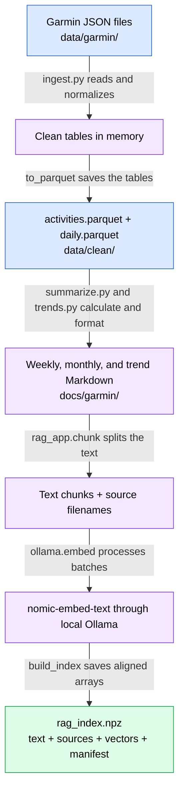
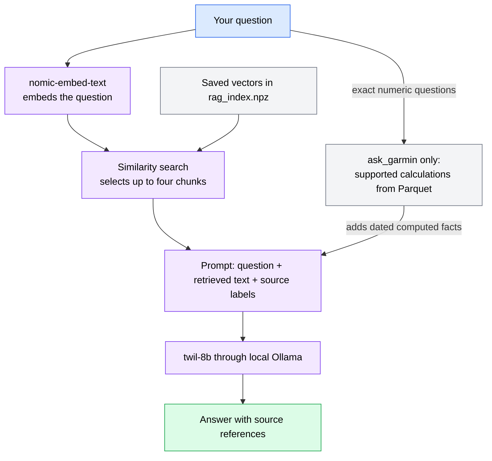

# TwIL Garmin demo

Analyze the Garmin account export already in `data/garmin`, generate local reports,
and ask a local TwIL model questions grounded in computed facts and documents.

## How the data pipeline works

Python prepares the data and computes the numbers. The embedding model makes the
written summaries searchable. TwIL receives selected evidence when you ask a
question; this process does not train or change TwIL's model weights.



GitHub renders the diagram directly. If your Markdown viewer shows the diagram's
source instead, the table below describes the same stages.

| Stage | What the code does | Result | Model call? |
|---|---|---|---|
| Read JSON | [`ingest.records()`](src/twil_demo/ingest.py) finds matching files recursively and parses dictionaries. | Raw records in memory | No |
| Normalize | `load_activities()` converts units and deduplicates IDs; `load_daily()` joins wellness measurements by calendar date. | Two pandas DataFrames | No |
| Save tables | `ingest()` calls `to_parquet()` and writes a coverage report. | `data/clean/activities.parquet`, `daily.parquet`, `ingestion_report.json` | No |
| Write summaries | [`summarize.py`](src/twil_demo/summarize.py) and [`trends.py`](src/twil_demo/trends.py) use shared [`metrics.py`](src/twil_demo/metrics.py) calculations and Markdown templates. | `docs/garmin/week_*.md`, `month_*.md`, `trends.md`, `patterns.md` | No |
| Split text | [`rag_app.build_index()`](src/twil_demo/rag_app.py) reads `.md` and `.txt` files under `docs/` and calls `chunk()`. | Text chunks paired with their source filenames | No |
| Embed and save | [`ollama.embed()`](src/twil_demo/ollama.py) obtains vectors; `build_index()` saves vectors, text, sources, and a freshness manifest. | `output/rag_index.npz` | `nomic-embed-text` only |

A DataFrame is a table in memory; Parquet is the compact file representation used
to reload it. The raw export stays intact. Detailed FIT files inside ZIP archives
are not required for this pipeline.

### Follow one activity through the pipeline

For illustration, these fields from a hypothetical activity:

```json
{"activityType": "running", "distance": 500000, "duration": 1800000}
```

become a row with `sport="run"`, `distance_km=5.0`, and `duration_min=30.0`.
The conversions divide centimetres by `100000` and milliseconds by `60000`.
The row also retains its activity ID, date, and source filename.

That row contributes to the week's totals. If a hypothetical week contains three
such runs, the generated Markdown includes:

```markdown
- run: 3 sessions, 1.5 hours, 15.0 km
```

The summary is formatted by Python, not written by TwIL. It includes measurement
coverage so a missing night of sleep is not mistaken for zero hours. Markdown
contains selected summaries; exact activity rows remain in Parquet. Details
omitted from the summaries cannot be recovered by searching their embeddings.

### What chunking and the index contain

`chunk()` currently takes at most **1200 characters**, with **180 characters of
overlap**, advancing 1020 characters at a time. These are character counts, not
words or tokens. Documents short enough to fit in a single slice stay whole;
longer documents are cut at fixed character positions, which can split a
sentence or field. Overlap repeats boundary text to preserve some context.

Chunks are embedded in batches of 16. For `nomic-embed-text`, document inputs
receive a `search_document: ` prefix. Each returned vector is normalized to unit
length, enabling cosine-similarity ranking with a dot product later.

The index is one compressed NumPy file, rather than a separate database server:

| Saved value | Purpose |
|---|---|
| `sources[i]` | Relative filename for chunk `i`, used to identify evidence |
| `texts[i]` | Original text of that chunk, supplied to TwIL after retrieval |
| `vectors[i]` | Numeric embedding of the same chunk, used for similarity search |
| `manifest` | Index version, embedding model name, and source-document SHA-256 hashes |

The three arrays correspond by position: item `i` refers to the same chunk in
each array. Embeddings support search; the original text remains necessary for
answering and checking citations. The saved index contains private text and
filenames alongside vectors; it is excluded from Git with the rest of `output/`.

### What happens when you ask a question



The query gets a `search_query: ` prefix. `retrieve()` compares its normalized
embedding with the stored vectors and returns up to four matching chunks.
`answer()` sends their text and the question to TwIL. The full index and vectors
are not included in the generation prompt. `ask_garmin` adds supported exact
table calculations; unsupported numeric requests stop with an explanation.
Date and sport filters in a numeric question constrain the table calculation;
semantic retrieval can still return excerpts from other dates. Responses show
the computed date range and retrieved source filenames separately.

Both models run through Ollama, but their jobs differ: **`nomic-embed-text`
produces vectors; `twil-8b` produces answers.** Neither model is called while
generating the Parquet files, Markdown summaries, charts, or static report.

## Activate the Python environment

From this project directory:

```bash
uv sync
source .venv/bin/activate
```

After activation, use `python` or `twil-demo` directly. Run `deactivate` to leave
the environment. Activate it again in each new terminal. `uv sync` installs the
package in editable mode; code edits take effect without reinstalling. Run it
again after dependency changes. `uv run ...` remains an alternative to activation.

## Prepare data and generate the report

```bash
python -m twil_demo refresh
```

This runs ingestion, summaries, trends, charts, and the HTML report in order.
It does **not** call a model or build the RAG index. It is safe to repeat when the
export changes. Open `output/dashboard/report.html` in your browser.

The equivalent individual commands are:

```bash
python -m twil_demo.ingest
python -m twil_demo.summarize
python -m twil_demo.trends
python -m twil_demo.charts
python -m twil_demo.build_report
```

`twil-demo refresh` is the shorter installed command. Use `twil-demo --help` or,
for example, `twil-demo ingest --help` for available commands and arguments.

## Start the local models

The GGUF and `Modelfile` are already in this checkout. Start Ollama in another
terminal, or open the Ollama application:

```bash
ollama serve
```

In your project terminal, set up the named models once:

```bash
ollama create twil-8b -f Modelfile
ollama pull nomic-embed-text
ollama list
```

The embedding model download needs internet access once. With both models
available locally, indexing and answering use Ollama at `http://localhost:11434`.
Test direct model chat, which does not retrieve any Garmin data:

```bash
python -m twil_demo.chat "Explain RAG in one sentence."
# Or start an interactive direct conversation:
python -m twil_demo.chat
```

## Build the RAG index, then ask questions

First, explicitly embed the `.md` and `.txt` documents under `docs/`:

```bash
python -m twil_demo.rag_app index
```

This calls `nomic-embed-text` and saves text, source filenames, and vectors in
`output/rag_index.npz`. An unchanged index is reused without model calls. When
documents change, run `index` again; use `index --force` to rebuild regardless.
This implementation rebuilds the whole index when any document changes.
Changing the chunking code requires `index --force`, because the manifest does
not record chunk-size or overlap settings.

For exact table-backed questions:

```bash
python -m twil_demo.ask_garmin "How many hours did I run in the last 4 weeks?"
python -m twil_demo.ask_garmin "What was my average sleep in the last 7 days?"
python -m twil_demo.ask_garmin "How many bike sessions from 2026-10-01 to 2026-10-31?"
```

The deliberately small numeric router supports total/mean session duration,
total/mean distance, activity counts, and average sleep, resting HR, or weight.
Ask one metric at a time. Specify `last N days/weeks` or two ISO dates. Without a
range, numeric questions use the latest 28 calendar days in the export, not the
current computer date. Unsupported calculations and ambiguous ranges are rejected
instead of approximated. Returned table facts include dates and measurement
coverage. Counts include transition records; multisport parent totals are removed
when their child legs are present.

For document questions, use:

```bash
python -m twil_demo.rag_app ask "What observations appear in the latest training summaries?"
python -m twil_demo.rag_app chat
```

Answering embeds your question, retrieves four relevant text chunks, and sends
those excerpts plus your question to `twil-8b`. The Garmin command also computes
supported exact facts from the Parquet tables. TwIL does not receive the full
embedding index. Document RAG cannot reliably find a global maximum or total by
looking at four chunks: use computed metrics for arithmetic. Model citation and
grounding instructions are prompts, not a guarantee; check returned facts and
source documents. A missing or stale index gives a rebuild instruction.

### Which command should I use?

| Command | Evidence supplied to TwIL | Use it for |
|---|---|---|
| `python -m twil_demo.chat` | Your prompt only | Checking the model or asking general questions |
| `python -m twil_demo.rag_app ask "..."` | Retrieved document excerpts and your question | Questions about information recorded in the summaries or other indexed documents |
| `python -m twil_demo.ask_garmin "..."` | Retrieved excerpts plus supported calculations from Parquet | Exact counts, duration/distance totals, or supported wellness averages |
| `python -m twil_demo.coach` | `goals.yaml` and computed `output/trends.json`; no retrieval | Interpreting saved trends against your personal goals |
| `twil-demo dashboard` | Charts/tables use Parquet; the Ask button calls `ask_garmin` | Browsing activity and wellness data, then asking a grounded question |

The two ask commands need the embedding model, TwIL, and a current index. Direct
chat and the coach need TwIL but do not use the RAG index. The dashboard's charts
and tables do not require either model.

### What to rerun after changes

| What changed? | What to run next |
|---|---|
| Garmin JSON export | `twil-demo refresh`, then `python -m twil_demo.rag_app index` |
| A hand-written `.md` or `.txt` document under `docs/` | `python -m twil_demo.rag_app index` |
| Chunk size, overlap, or splitting logic | `python -m twil_demo.rag_app index --force` |
| Embedding model | Rebuild with `python -m twil_demo.rag_app index --force` |
| Personal `goals.yaml` | Run the coach again; no RAG rebuild needed |

`refresh` stops after building the report. Indexing is a separate explicit step
that requires Ollama. Document hashes detect changed Markdown/text, not changes
to raw JSON or Parquet: refresh the summaries before rebuilding the index.
All reports describe the export snapshot. They do not fetch live Garmin data.

## Optional interactive dashboard

```bash
uv sync --extra dashboard
source .venv/bin/activate
twil-demo dashboard
```

This starts Streamlit on localhost. Alternatively:

```bash
python -m streamlit run src/twil_demo/dashboard.py --server.address 127.0.0.1
```

Date and sport filters control activity views; date filters control wellness
views. The saved pattern observations and Ask panel describe the full export
independently of those filters, as labelled in the UI. The charts and tables work
without Ollama; the Ask button requires both Ollama and a current RAG index.
Use `uv sync --extra dashboard` when synchronizing to keep the optional packages.

## Goals and coach

On a fresh checkout, copy `goals.example.yaml` to `goals.yaml` once. Your personal
`goals.yaml` is ignored by Git; only the generic example is shared. Edit the local
file with your actual preferences and race dates, then run:

```bash
python -m twil_demo.coach
```

This explicitly calls TwIL with the saved `output/trends.json` and your goals.
The template assumes no race dates, training targets, or physiological thresholds.
Currently, goals are used only by the coach; they are not automatically supplied
to either ask command or to the dashboard's Ask panel. Editing goals does not
change chart values or computed training facts.

## How this export is interpreted

- Activities: `DI_CONNECT/DI-Connect-Fitness/*summarizedActivities.json`, unwrapped
  from each `summarizedActivitiesExport` list. Distance is centimetres; duration
  is milliseconds. Deduplication uses `activityId`. Local start time determines
  the reporting date; UTC start time is retained separately.
- Daily wellness: `DI-Connect-Aggregator/UDSFile_*.json` provides resting HR and
  total-day stress. Missing measurements remain null on a complete daily calendar.
- Sleep: main sleep hours are deep + light + REM seconds divided by 3600. Awake
  time is excluded. Naps are stored separately as `nap_hours`. Overlapping main
  sleep records prefer confirmed-final, complete stage data, then latest end.
- Weight: nested dated measurements from `*userBioMetrics.json`, grams to pounds.
  Multiple measurements on a day use the latest available timestamp.
- VO2 max: `MetricsMaxMetData_*.json` retains running and cycling measurements
  separately; the compatibility `vo2max` column prefers running when both occur.
- Garmin readiness and native acute/chronic load metrics are also retained in
  the daily table. They are distinct from the report's calculated load ratio.
- The calculated load ratio is 7-day mean / 28-day mean of activity load. A
  recorded session without load makes that day's ratio inputs unknown; a
  transition without independent load counts as zero load. Days without sessions
  are treated as rest within the export's coverage. Windows with missing load
  stay unavailable. No missing-load estimates are invented.
- Seven-day chart averages require four observed measurements. Report cards
  display observed-measurement averages with coverage alongside them.
- ZIP archives remain intact. They are optional future sources for laps, GPS,
  HR time series, and other details, rather than required inputs for this build.

Read `data/clean/ingestion_report.json` for counts, coverage, and multisport
warnings after each refresh. Replace/update the raw export before refreshing;
this is a snapshot workflow, not a Garmin account connection.

## Files

```text
data/garmin/              Existing raw Garmin export
data/clean/               activities.parquet, daily.parquet, ingestion report
docs/garmin/              Generated weekly/monthly summaries, trends, patterns
models/                   Existing GGUF model
src/twil_demo/            Importable modules and command entry points
output/charts/            Four PNG charts
output/dashboard/         Static HTML report
output/trends.json        Computed facts for the coach
output/rag_index.npz      Persisted document index (after indexing)
goals.yaml                Private editable preferences (ignored)
goals.example.yaml        Generic goals template safe to share
tests/                    Synthetic data and mocked-model regression tests
```

Exports, model files, personal goals, credentials, and generated outputs are
excluded from Git. Ignore rules also block common data, archive, document, media,
and model extensions outside the usual folders. Code, Markdown documentation,
`goals.example.yaml`, and `uv.lock` remain eligible for version control. Review
`git status` before committing; ignore rules cannot detect private text pasted
into source files or prevent an explicit `git add -f`.

No model or network requests occur when importing modules. Preparation/report commands make
no model calls. `TWIL_PROJECT_ROOT` can override the checkout root, and
`TWIL_OLLAMA_URL`, `TWIL_CHAT_MODEL`, `TWIL_EMBED_MODEL` configure the local client.
Changing the embedding model requires rebuilding the index.

## Verify

```bash
python -m unittest discover -s tests -v
```

Tests use synthetic data and mock Ollama calls; they do not require the model
server or send your Garmin data elsewhere.
